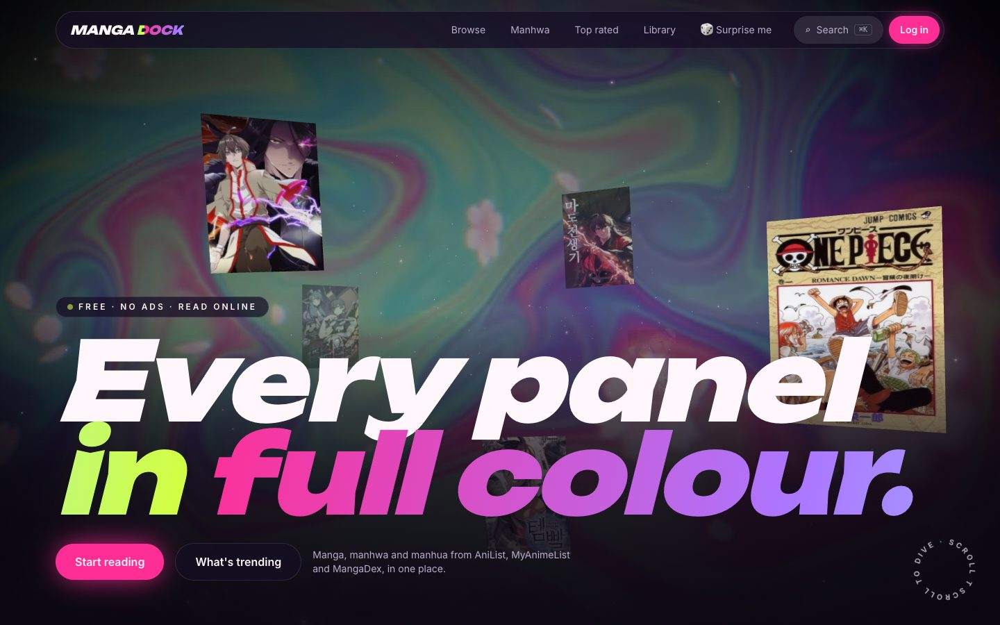
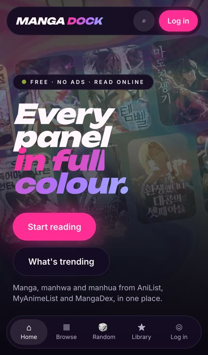
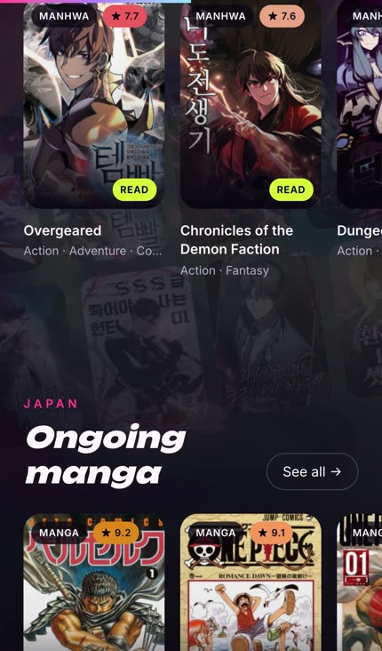
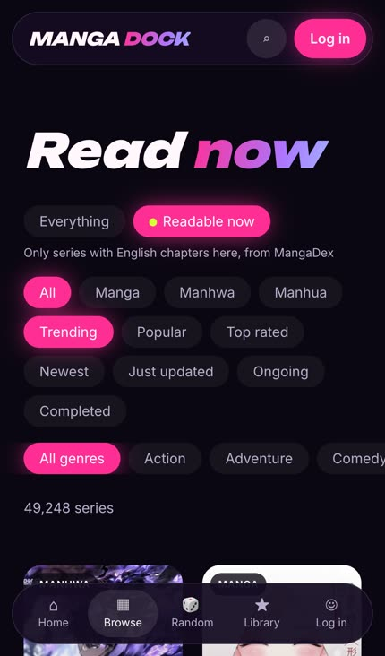
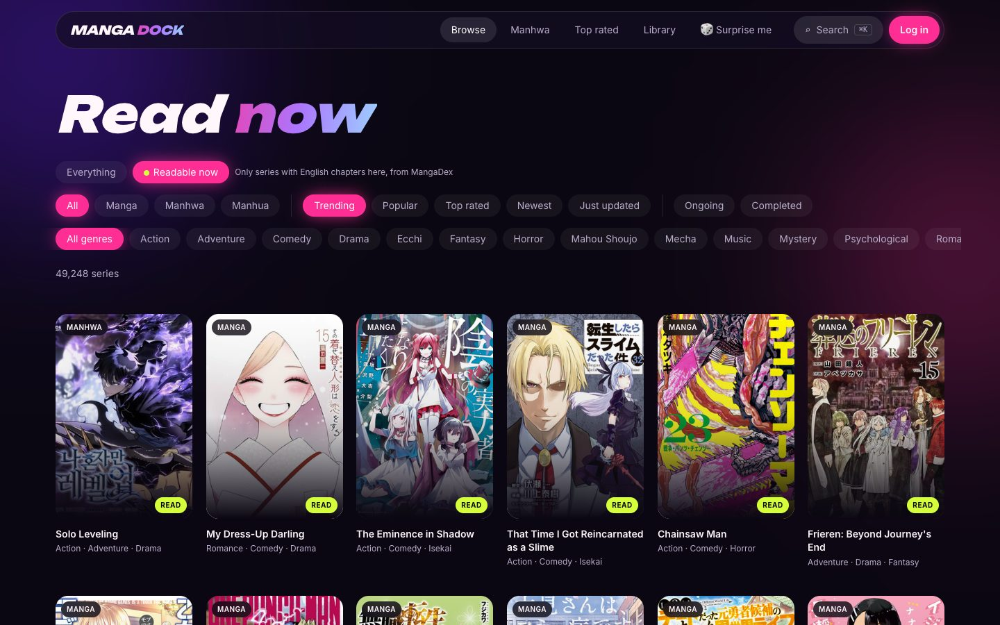
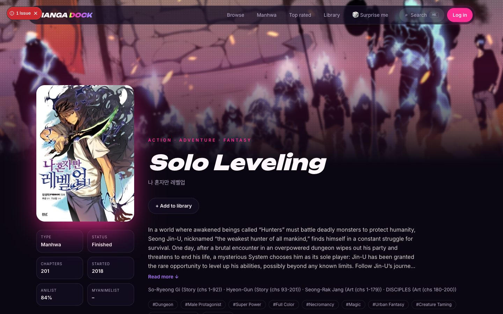
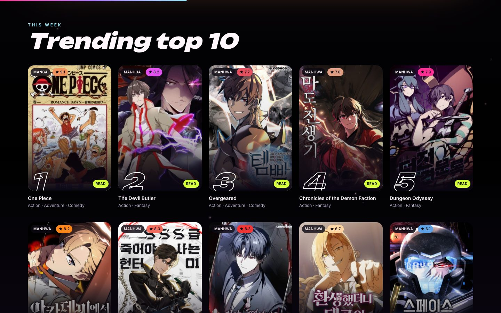
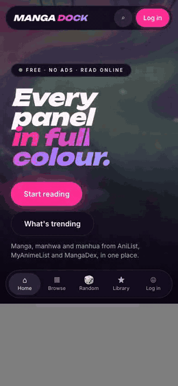

<p align="center">
  
</p>

<h1 align="center">MangaDock</h1>

<p align="center">
  A free, ad-free, open-source place to discover and read manga, manhwa and manhua.<br>
  <b>55,093</b> MangaDex titles indexed · <b>49,248</b> readable in English · the full AniList catalog to browse
</p>

<p align="center">
  <a href="https://mangadock.vercel.app"><b>Open MangaDock ↗</b></a> ·
  <a href="#run-it">Run it</a> ·
  <a href="#features">Features</a> ·
  <a href="#screenshots">Screenshots</a> ·
  <a href="#catalog-index">Catalog index</a> ·
  <a href="#rules-we-follow">Rules</a> ·
  <a href="#contributors">Contributors</a>
</p>

<p align="center">
  <a href="https://github.com/satiricalguru/MangaDock/actions/workflows/ci.yml"></a>
  <a href="LICENSE"></a>
  <a href="CONTRIBUTING.md"></a>
</p>

<p align="center">
  
</p>

## Features

- **Homepage:** a WebGL scroll scene (React Three Fiber). A looping hero video plays through a custom shader with liquid flow, a pointer ripple, a hue shift as you scroll, manga halftone and a chromatic split on fast scrolls. The camera flies through a tunnel of this week's trending covers.
- **Homepage on phones:** no WebGL (it crashed iOS WebKit). Instead the poster drifts slowly, two rows of trending covers float behind the headline, and sections fade in as you scroll. All of it is CSS transforms and one-shot transitions, so no animated layers pile up. Visitors with reduced motion or Save-Data get a still image.
- **Browse** (`/browse`): search, plus filters for type (manga / manhwa / manhua), sort, status and genre, from two sources:
  - **Everything:** the full AniList catalog. Cards marked **Read** have English chapters here.
  - **Readable now** (`?src=md`): straight from MangaDex, so every result opens in the reader. That includes about 16,000 English series AniList doesn't list.
- **Title pages** (`/manga/[anilistId]`): AniList info, the MyAnimeList score (via Jikan), characters, official reading links, recommendations and chapters from MangaDex in every available language.
- **MangaDex-only titles** (`/title/[mangadexId]`): info, chapters, library and reading progress for series that aren't on AniList.
- **Reader** (`/read/[chapterId]`): strip or paged mode with Right-to-Left (RTL) manga pagination support, progress bar, width slider, data-saver mode, ← → keys between chapters, and scanlation-group credits on every chapter.
- **Library and progress:** reading, plan to read, completed and favourites. Progress is saved to the page, in the browser for guests and to your account when signed in.
- **Quick search:** press `/` or ⌘K anywhere. Results come from AniList and MangaDex together.
- **Installable:** add it to your phone's home screen and it opens full-screen with its own icon.

## Screenshots

<table>
  <tr>
    <td width="33%"></td>
    <td width="33%"></td>
    <td width="33%"></td>
  </tr>
  <tr>
    <td align="center">Phone hero</td>
    <td align="center">Shelves with <b>Read</b> badges</td>
    <td align="center">Readable now</td>
  </tr>
</table>

| Browse: Readable now | Title page |
|---|---|
|  |  |



### Phone tour

<p align="center">
  <br>
  <a href="docs/media/phone-tour.mp4">▶ Watch the full video (MP4)</a>
</p>

## Run it

Needs Node 20.9 or newer.

```bash
npm install
npm run dev      # http://localhost:3000
```

Production: `npm run build && npm start`, or deploy to Vercel (accounts are stored in Turso there; see `lib/db.ts`).

## Catalog index

`lib/data/catalog.json` maps every MangaDex title to its AniList (or MyAnimeList) id, so a title page finds its chapters with one exact lookup instead of guessing by name.

| | Titles |
|---|---:|
| MangaDex titles with chapters (safe + suggestive) | 55,093 |
| … with English chapters | 49,248 |
| … linked to AniList | 33,160 |
| … linked only to MyAnimeList | 2,340 |
| English titles on neither (shown via **Readable now**) | 16,174 |

Rebuild it every few weeks to pick up new series (about 10 minutes, under MangaDex's rate limit):

```bash
node scripts/build-catalog.mjs
```

Titles added since the last build still work: they fall back to a live MangaDex title search.

## Rules we follow

- No ads, no paid features, ever (a MangaDex requirement).
- Credit MangaDex and the scanlation group on every chapter, and honour takedown requests.
- AniList is free for non-commercial use. All API calls are cached server-side (AniList 30 min, Jikan 24h, MangaDex 10 min).
- Webtoons and Anime-Planet have no public API, so we link to them instead of copying them.
- Licensed series point to official platforms when MangaDex has no chapters.

## Where things live

| Path | What |
|---|---|
| `components/hero/` | WebGL scene, shaders and phone fallback |
| `components/Reveal.tsx` | Scroll-reveal for phones and older browsers |
| `lib/anilist.ts`, `lib/jikan.ts`, `lib/mangadex.ts` | API clients |
| `lib/catalog.ts` | Reads the catalog index |
| `app/api/img` | Same-origin image proxy (WebGL textures, MangaDex covers) |
| `app/icon.svg`, `app/manifest.ts` | App icon and install manifest |
| `public/media/` | Hero video (seamless 8.5s loop, MP4 + WebM) and poster |
| `app/globals.css` | Colour tokens and utilities |
| `scripts/build-catalog.mjs` | Crawls MangaDex and writes the catalog index |
| `scripts/icons.mjs` | Renders the icon PNGs from `app/icon.svg` |
| `scripts/readme-media.mjs` | Captures the screenshots, GIF and video in `docs/media` |

## Contributors

<table>
  <tr>
    <td align="center"><a href="https://github.com/satiricalguru"><br><b>satiricalguru</b></a><br>Creator · maintainer</td>
    <td align="center"><a href="https://github.com/Mxhi-04"><br><b>Mxhi-04</b></a><br>Collaborator</td>
  </tr>
</table>

Want to help? Read [CONTRIBUTING.md](CONTRIBUTING.md). Thanks also to the AniList, Jikan and MangaDex teams, and to the scanlation groups credited on every chapter.

## License

[MIT](LICENSE) for MangaDock's code, icon and design. Cover art in the screenshots belongs to its creators and publishers; it's shown as it appears on the live site, served from AniList and MangaDex.
